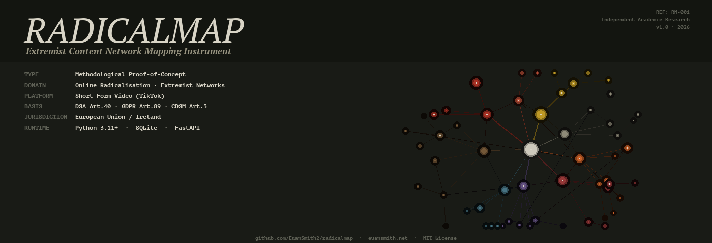

# RadicalMap



    
[](https://doi.org/10.5281/zenodo.22083807)

```
╔══════════════════════════════════════════════════════════════════════╗
║  RADICALMAP                                            REF: RM-001  ║
║  Extremist Content Network Mapping Instrument                       ║
║────────────────────────────────────────────────────────────────────-║
║  Type: Independent Academic Research        Status: Open — v1.0     ║
║  Basis: DSA Art.40 · GDPR Art.89 · CDSM Dir. Art.3                 ║
║  Jurisdiction: European Union / Ireland     Runtime: Python 3.11+   ║
╚══════════════════════════════════════════════════════════════════════╝
```

**A research instrument for detecting, classifying, and visualising extremist content networks on short-form video platforms.**

Short-form video platforms have become one of the primary vectors through which far-right ideology, white nationalist content, and radicalisation material circulates to mass audiences. This content does not announce itself. It travels through coded hashtags, numerical dog whistles embedded in usernames, hidden capitalisation sequences, and multilingual slogans designed to evade automated moderation. It clusters into interconnected networks that are invisible to casual observation but structurally coherent to computational analysis.

RadicalMap is a methodological proof-of-concept demonstrating that these networks can be detected, mapped, and classified at scale using publicly accessible metadata — and that the resulting analysis is directly usable by researchers, platform trust and safety teams, policy makers, and law enforcement operating under existing EU and Irish legal frameworks.

> **Research disclaimer:** This tool catalogues, classifies, and analyses extremist content for the purposes of detection and academic study. It does not endorse, promote, or affiliate with any ideology, movement, organisation, or viewpoint documented within it. The content analysed — including white nationalist material, antisemitic content, and radicalisation-adjacent media — is reproduced solely for identification, classification, and scholarly examination. See the [Legal Framework](#legal-framework) section for the full statutory basis governing this research.

---

## The Problem This Addresses

### What the platforms say

TikTok's Community Guidelines — the standards TikTok itself commits to enforcing — explicitly prohibit the categories of content RadicalMap detects. Under their **Hateful Behaviour** policy, TikTok states:

> "We define hate speech as content that attacks, threatens, incites violence against, or dehumanises an individual or a group based on protected attributes including: race, ethnicity, or national origin; religious affiliation; gender or gender identity; sexual orientation; immigration status; disability or serious illness."

Under the same policy, TikTok specifically prohibits content that:

> "promotes or supports any form of hateful ideology that treats people as less than human, including white supremacist content, such as references to the 'great replacement' theory."

Their **Dangerous Individuals and Organisations** policy extends this:

> "We do not allow dangerous individuals or organizations to use our platform to promote terrorism, crime, or other types of behaviour that could cause harm. We also do not allow content that praises, promotes, glorifies, or supports dangerous individuals or organizations."

TikTok's Community Guidelines on **Violent Extremism** state that the platform will remove content that:

> "incites, promotes, or glorifies acts of political, social, racial, or religious violence — including terrorism, genocide, or mass atrocities — or the individuals and groups who commit them."

### What actually happens

The content network documented in this tool's development dataset — 18 publicly accessible TikTok videos from a single interconnected cluster — contains material spanning white nationalist ideology, accelerationist rhetoric, antisemitic conspiracy theory, incel dehumanisation, and explicit radicalisation pipeline markers. All of it was publicly accessible. None of it was obscure or difficult to locate once the network logic was understood.

The gap between platform policy and platform reality is not a technical accident. It is a structural consequence of moderation systems that scan for explicit keywords while remaining blind to the coded language, numerical substitution, multilingual obfuscation, and cross-platform network logic through which extremist communities actually operate.

RadicalMap addresses that gap with a tool built specifically to read the language these communities use.

---

## Regulatory and Legislative Context

The development of tools like RadicalMap is not merely permitted under EU and Irish law — it is actively mandated by the regulatory frameworks governing Very Large Online Platforms (VLOPs) like TikTok.

### Digital Services Act (EU)

TikTok operates as a Designated Very Large Online Platform under **Regulation (EU) 2022/2065 (Digital Services Act)**. Under **Article 34(1)**, VLOPs are required to conduct annual risk assessments covering:

> "...actual or foreseeable negative effects on civic discourse and electoral processes, and public security."

The content categories identified and mapped by this tool — white nationalist ideology, accelerationist material, coordinated radicalisation pipelines — fall squarely within the systemic risk categories TikTok is legally obligated to monitor and mitigate.

**DSA Article 35(1)** then requires VLOPs to implement reasonable risk mitigation measures:

> "Providers of very large online platforms and of very large online search engines shall put in place reasonable, proportionate and effective mitigation measures, tailored to the specific systemic risks identified pursuant to Article 34."

Independent research instruments that identify and classify content constituting systemic risk under Article 34 directly support the accountability infrastructure the DSA creates.

**DSA Article 40(4)** creates a specific right of researcher access:

> "Providers of very large online platforms or of very large online search engines shall provide, at the request of the Digital Services Coordinator of establishment, or the Commission, access to data to vetted researchers who meet the requirements set out in paragraph 8 for the sole purpose of conducting research that contributes to the detection, identification and understanding of systemic risks in the Union."

The methodology demonstrated here directly serves the research purposes enumerated in Article 40.

### Irish Law

The content catalogued by this tool may constitute criminal offences under Irish law. The identification and documentation of such content is a necessary precondition for law enforcement referral and policy intervention.

**Criminal Justice (Incitement to Violence or Hatred and Hate Offences) Act 2024 (No. 34 of 2024), Section 7** provides:

> "A person who prepares or possesses material — (a) with a view to the material being communicated to the public or a section of the public, whether by himself or herself or another person, and (b) with intent to incite violence against, or hatred of, a person or a group of persons on account of their protected characteristics or any of those characteristics, is guilty of an offence."

**Section 10** of the same Act creates an offence of distributing material likely to incite hatred, carrying penalties of up to five years' imprisonment on indictment. Research that identifies and classifies content potentially falling within these provisions supports the legislative intent of the Act.

---

## What RadicalMap Does

RadicalMap ingests publicly accessible short-form video metadata and constructs an interactive network graph revealing:

- **Video nodes** — individual TikTok videos with engagement statistics (views, likes, comments, shares, saves)
- **Hashtag nodes** — co-occurring hashtags classified by ideological category and severity
- **Comment analysis** — flags comments containing coded language, numerical codes (88, 1488, 14), recruitment language, and dog whistles
- **Text analysis** — detects hidden capitalisation codes (e.g. `StreSS` → SS rune), multilingual extremist signals (Swedish Great Replacement slogans, Spanish fascist phrases), and username-embedded numerical codes
- **Bio analysis** — scans account bios for known extremist identifiers and affiliation markers
- **Network clustering** — co-occurrence edges reveal which hashtags travel together, exposing the structural logic of ideological clusters

### Classification framework

| Category | Description |
|---|---|
| `white_nationalist` | Neo-Nazi ideology, ethnonationalism, Aryan mysticism |
| `antisemitic` | Conspiracy theories, slurs, coded language targeting Jewish people |
| `conspiracy` | Suppressed history claims, secret elite theories used to justify hatred |
| `radicalisation` | Entry points and pipeline markers — content designed to move users toward more extreme positions |
| `dehumanisation` | Rhetoric stripping out-groups of human qualities; incel misogyny |
| `esoteric` | Occult content with documented far-right adoption (Vril, Hyperborea, Kali Yuga) |
| `islamophobic` | Hatred targeting Muslim people or Islamic practice |
| `incel` | Involuntary celibate ideology; misogynistic, often nihilistic and violence-adjacent |
| `accelerationist` | Advocacy for societal collapse or race war as a political strategy |

Severity is rated `low` / `medium` / `high` per classified item.

The dog whistle dictionary (`data/dictionary.json`) contains 48 classified terms with academic definitions, origin notes, category assignments, and severity ratings — each sourced from Urban Dictionary (for generic slang), curated academic sources, or documented extremist community usage.

---

## Applications

### Academic research

RadicalMap provides a reproducible methodological framework for the computational study of online radicalisation. The tool's classification system, network graph output, and structured comment flagging are designed for integration into peer-reviewed research on:

- Online radicalisation pathways and pipeline mechanics
- The spread and mutation of coded extremist language across platforms
- Cross-platform network mapping (CIB — Coordinated Inauthentic Behaviour)
- The effectiveness of content moderation systems against sophisticated evasion techniques

The 48-entry dog whistle dictionary is structured for systematic expansion and can support longitudinal studies tracking how terminology evolves in response to moderation pressure.

### Social media platform trust and safety

Platform moderation teams operating under DSA Article 35 risk mitigation obligations can use this tool's methodology to:

- Audit the effectiveness of existing keyword filters against coded language
- Map cross-community hashtag co-occurrence patterns that evade single-keyword detection
- Identify bridging accounts that serve as connective tissue between otherwise isolated extremist clusters
- Generate structured, categorised content reports for enforcement action

The detection methodology — particularly the hidden capitalisation scanner and multilingual signal detection — addresses evasion techniques that standard automated moderation systems are not designed to catch.

### Policy and legislative research

RadicalMap produces structured, reproducible evidence of the gap between platform content policies and enforcement reality. For policy researchers and legislative advisors working on:

- Digital Services Act implementation and compliance monitoring
- Online safety regulation at national level
- Platform accountability frameworks
- Evidence-based hate speech legislation

The tool provides a concrete, citable demonstration of how publicly accessible extremist content networks operate in practice, with full legal grounding in existing EU and Irish law.

### Law enforcement

The identification and documentation of content potentially constituting offences under the **Criminal Justice (Incitement to Violence or Hatred and Hate Offences) Act 2024** supports referral to An Garda Síochána, Europol, and other competent authorities. RadicalMap's structured output — categorised by offence type, severity, and statutory relevance — is designed to be usable as an evidence collation framework, not merely an analytical dashboard.

---

## Ethical Framework and Data Handling

This research has been conducted with a consistent commitment to minimising harm and operating within the strictest interpretation of applicable ethical and legal standards.

**What is collected:** Publicly available metadata only — video captions, usernames, account bios, hashtags, and engagement statistics (views, likes, comments, shares, saves). No private or non-public data is accessed or stored at any point.

**What is not collected:** Private messages, non-public account data, direct message content, payment information, or any data requiring authenticated or privileged access.

**Data minimisation:** No data held in this project links individuals to sensitive characteristics beyond what they have publicly self-disclosed on public-facing account profiles.

**Storage:** Data is held locally in a SQLite database. The database file is excluded from this repository and is never distributed.

**Video files:** Where video files are downloaded for local transcript analysis, they are stored locally only and are not redistributed. They remain the intellectual property of their respective creators and platform.

**Misuse prevention:** This tool is designed for research, policy, and law enforcement use. It is not designed for, and must not be used for: surveillance of individuals outside a public-interest research context; targeted harassment or identification of private individuals; any commercial purpose involving the resale of scraped data; or any purpose that would itself constitute incitement to hatred or violence under applicable law.

---

## Legal Framework

### Research disclaimer

This tool was developed strictly for academic research, counter-disinformation analysis, and educational purposes. It catalogues, classifies, and visualises extremist content that is publicly accessible on short-form video platforms.

The researcher does not hold, endorse, promote, or affiliate with any of the ideologies, movements, organisations, or viewpoints documented within this tool. This project represents a small-scale methodological sample. The dataset used in development was selected to demonstrate the tool's detection and classification capabilities across a single interconnected content cluster. It is not a comprehensive or statistically representative survey.

### GDPR — Scientific research exemption

The collection and processing of publicly accessible social media metadata is conducted under the scientific research exemption:

**Regulation (EU) 2016/679 (General Data Protection Regulation), Article 89(1):**

> "Processing for archiving purposes in the public interest, scientific or historical research purposes or statistical purposes, shall be subject to appropriate safeguards, in accordance with this Regulation, for the rights and freedoms of the data subject. Those safeguards shall ensure that technical and organisational measures are in place in particular in order to ensure respect for the principle of data minimisation."

**GDPR Recital 159:**

> "When personal data are processed for scientific research purposes, this Regulation should also apply to that processing. For the purposes of this Regulation, the processing of personal data for scientific research purposes should be interpreted in a broad manner including for example technological development and demonstration, fundamental research, applied research and privately funded research."

**Irish Data Protection Act 2018, Section 42(1):**

> "Personal data may be processed for archiving purposes in the public interest, scientific or historical research purposes or statistical purposes subject to appropriate safeguards for the rights and freedoms of data subjects..."

### Text and data mining — copyright exception

**Directive (EU) 2019/790 on Copyright in the Digital Single Market (CDSM Directive), Article 3(1):**

> "Member States shall provide for an exception to the rights provided for in Article 5(a) and Article 7(1) of Directive 96/9/EC, Article 2 of Directive 2001/29/EC, and Article 15(1) of this Directive for reproductions and extractions made by research organisations and cultural heritage institutions in order to carry out, for the purposes of scientific research, text and data mining of works or other subject matter to which they have lawful access."

This exception was transposed into Irish law by **Statutory Instrument No. 567 of 2021** (European Union (Copyright and Related Rights in the Digital Single Market) Regulations 2021), amending the Copyright and Related Rights Act 2000.

### Freedom of expression and academic freedom

**European Convention on Human Rights, Article 10(1):**

> "Everyone has the right to freedom of expression. This right shall include freedom to hold opinions and to receive and impart information and ideas without interference by public authority and regardless of frontiers."

Cataloguing extremist content for research purposes does not constitute promotion or publication of that content. It falls outside the scope of permissible restrictions under Article 10(2), which requires any restriction on expression to be "necessary in a democratic society."

**Bunreacht na hÉireann (Irish Constitution), Article 40.6.1°(i):**

> "The State guarantees liberty for the exercise of the following rights, subject to public order and morality: The right of the citizens to express freely their convictions and opinions."

### Platform terms of service

TikTok's Terms of Service restrict automated access to the platform. The researcher notes:

1. All content analysed was publicly accessible without authentication at the time of collection.
2. The collection is strictly non-commercial and conducted for research purposes.
3. **DSA Article 40** creates a legal obligation on VLOPs to facilitate researcher access for systemic risk research — a right that supersedes platform-level contractual restrictions under EU law to the extent necessary for legitimate research.

*This legal section was prepared in good faith with reference to applicable EU and Irish law as at 2026. It does not constitute legal advice. Users of this tool are responsible for assessing the legal framework applicable in their own jurisdiction.*

---

## Setup

### Requirements

- Python 3.11+
- Firefox (for cookie-based metadata scraping)
- `yt-dlp` (bundled via venv)

```bash
git clone https://github.com/EuanSmith2/radicalmap
cd radicalmap
python3 -m venv venv
venv/bin/pip install -r requirements.txt
```

### Ingest videos

1. Add TikTok URLs to `data/sample_urls.txt` (one per line)
2. Run the ingest pipeline:

```bash
venv/bin/python -m scraper.manual_ingest
```

Fetches metadata, hashtags, captions, engagement stats, and downloads transcripts where available.

### Analyse text

```bash
venv/bin/python -m scraper.analyse_text
```

Scans captions, bios, and usernames for coded language, hidden capitalisation codes, multilingual signals, and numerical codes.

### Run the map

```bash
venv/bin/uvicorn frontend.app:app --reload --port 5001
```

Open `http://localhost:5001`

### Fable AI analysis (optional)

With an Anthropic API key, run the three-pass analytical model across all ingested videos:

```bash
export ANTHROPIC_API_KEY=sk-ant-...
venv/bin/python -m analysis.run_fable
```

Results are saved to `data/fable_results.json`. Each video is processed independently; the run is crash-safe and resumable.

---

## Project Structure

```
scraper/
  manual_ingest.py      — fetches video metadata via yt-dlp
  flag_patterns.py      — centralised comment flagging patterns
  analyse_text.py       — caption/bio/username analysis
  fetch_bios.py         — scrapes TikTok profile bios
  refresh_stats.py      — re-fetches live engagement stats
  import_comments.py    — imports comment JSON files
  reflag_comments.py    — re-runs flag logic against existing comments

db/
  schema.sql            — SQLite schema
  database.py           — connection and query helpers

analysis/
  graph_builder.py      — builds vis.js graph from DB
  dictionary.py         — loads the dog whistle dictionary
  fable-analyst-prompt.txt  — system prompt for AI analysis
  run_fable.py          — batch AI analysis runner

data/
  dictionary.json       — dog whistle dictionary (48 entries)
  sample_urls.txt       — input URLs (excluded from repo)

frontend/
  app.py                — FastAPI server
  static/
    index.html          — map UI
    app.js              — vis.js graph + interaction logic
    styles.css          — dark archival aesthetic
```

---

## Contributing to the Dictionary

`data/dictionary.json` accepts contributions via pull request. New entries should follow the format:

```json
"termname": {
  "display_name": "#TermName",
  "category": "white_nationalist",
  "severity": "high",
  "definition": "2-3 sentence academic definition.",
  "origin": "Origin, etymology, and community adoption history."
}
```

Contributions should include a source — academic paper, documented extremist community usage, or vetted journalistic investigation. Entries sourced from Urban Dictionary alone should be marked accordingly.

---

## Attribution

Developed by **Euan Smith** — [euansmith.net](https://euansmith.net)

This project is independent academic research. It is not affiliated with, commissioned by, or conducted on behalf of any organisation, institution, research body, platform, government agency, or third party. All research decisions, methodology choices, and content classification judgements are the sole responsibility of the researcher.

For research enquiries, methodology questions, or collaboration:  
[euansmith.net](https://euansmith.net)

MIT License — see [LICENSE](LICENSE) for terms.
