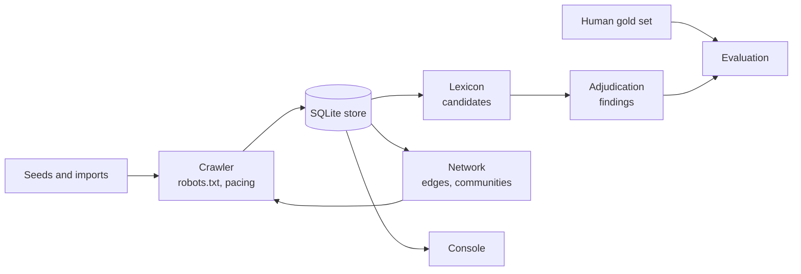

# RadicalMap


   
[](https://doi.org/10.5281/zenodo.22083807)

**A research instrument for detecting, classifying, and visualising extremist content networks on short-form video platforms.**

Extremist content on short-form video rarely announces itself. It travels through coded hashtags, numbers in usernames, hidden capitalisation, multilingual slogans and links written so a filter won't read them as links. Each piece looks like nothing on its own. Mapped together, the accounts, hashtags, sounds and links form networks with a clear structure.

RadicalMap collects publicly accessible metadata, flags the coded language, and maps the network it sits in, so researchers can study how these communities organise and how they evade moderation.

> **Research disclaimer:** This tool catalogues, classifies and analyses extremist content for detection and academic study. It does not endorse, promote or affiliate with any ideology, movement, organisation or viewpoint documented in it. See [LEGAL.md](LEGAL.md) for the legal framework and data-handling commitments.

## Versions

| | Where | What it is |
|---|---|---|
| **v1.0** | `main`, [DOI 10.5281/zenodo.22083807](https://doi.org/10.5281/zenodo.22083807) | The citable proof of concept: 18 TikTok videos from one interconnected cluster, a force-directed graph, single-stage regex flagging |
| **v2** | this branch | A rebuild for scale: a platform-agnostic store, a crawler that finds content on its own, two-stage classification measured against human labels, a multi-modal network, and an analysis console |

Everything below describes v2.

## What it detects

**Coded language.** Numeric codes (`1488`, `88`) in text and usernames, hidden capitalisation (`StreSS` for the SS), phonetic evasions (`sik haj`), and slogans in Swedish and Spanish as well as English. The lexicon has 78 entries in three tiers, where the tier says how ambiguous an entry is, not how severe:

| Tier | Meaning | Alone, is it a candidate? |
|---|---|---|
| A | Little innocent use (`1488`, `day of the rope`) | Yes |
| B | Real innocent uses exist (`noticing`, `great replacement`) | Yes, for adjudication to check |
| C | Mostly innocent (`based`, `link in bio`) | Only with a second, different tier-C signal |

**Hidden links.** Telegram, Discord and other off-platform links are extracted from captions, bios, link-in-bio fields, transcripts and comments, including obfuscated forms like `t dot me slash x` and `t(.)me/x`. Two accounts pointing at the same channel is one of the strongest ties in the network.

**Shared sounds.** A shared sound counts as a stronger tie than a shared hashtag: a hashtag can be dropped in seconds, but changing a video's sound means re-editing it. Sounds are first-class nodes, and an acoustic fingerprint catches the same audio re-uploaded under a new sound id after a takedown.

**Alt accounts.** Username pattern matching finds the "third account" a bio mentions: shared stems, version suffixes, rare shared tokens.

**Mentions.** An @-mention is a deliberate pointer from one account to another. It becomes an edge, and the crawler follows it.

### The taxonomy

A finding has three parts, recorded separately:

- **Domain:** what the content is about (22 domains in 7 families, for example `neo_nazi`, `maoist`, `jihadist`, `manosphere_incel`, `qanon`).
- **Harm type:** what makes it a finding (`incitement_to_violence`, `dehumanisation`, `recruitment`, and 9 others, including `none`).
- **Stance:** how the speaker relates to it (`promoting`, `recruiting`, `reporting`, `countering`, `help_seeking`, and 4 others).

Communism and Maoism are lawful political traditions with elected parties across the EU, so they are domains, never harms on their own. A post is a finding only when all three line up: a real harm type and a promoting, glorifying or recruiting stance. A journalist reporting on extremism, or someone describing their own distress, is never recorded as a perpetrator.

Jihadist entries match organisational markers only (proscribed groups' slogans and media brands), never ordinary religious vocabulary.

## How it works



1. The crawler collects from seed URLs, tags and searches, then expands through the network it finds, scoring each next step and logging every decision.
2. The lexicon proposes candidates. It is tuned for recall and deliberately over-flags.
3. Adjudication decides which candidates hold up in context and assigns domain, harm type and stance.
4. People label a stratified sample, and every reported number is measured against those labels.

The full design is in [docs/ARCHITECTURE.md](docs/ARCHITECTURE.md).

## Quickstart (offline, no data, no keys)

```bash
git clone https://github.com/EuanSmith2/radicalmap
cd radicalmap
python3 -m venv .venv && . .venv/bin/activate
pip install -e ".[dev]"

radicalmap demo                                      # builds db/radicalmap.demo.db
RADICALMAP_DB=db/radicalmap.demo.db radicalmap serve # http://127.0.0.1:5173
```

The demo runs the whole pipeline on an invented corpus. It shows candidates at every tier, clean controls that produce nothing, and hard negatives such as "I am a jew" or "the aryan languages of the Indo-Iranian branch", which the lexicon proposes and adjudication exists to reject.

Run the tests with `python tests/run_all.py`. They never touch the network. CI runs them on Python 3.11, 3.12 and 3.13.

## Collecting real data

Live collection is off until you turn it on.

```bash
export RM_ALLOW_NETWORK=1
radicalmap seed --file seeds.txt            # one URL per line
radicalmap discover noticing --type tag_page
radicalmap collect --max-items 5000
radicalmap graph build
radicalmap classify scan
```

TikTok collection reads the JSON each page embeds for its own rendering, so it gets the platform sound id, structured mentions, author bio and link-in-bio, and pinned/ad/region flags. Comments and replies come from the public comment endpoints, paced between pages. Caps, a date window, pinned-post exclusion and the rest are environment variables, listed in [docs/ARCHITECTURE.md](docs/ARCHITECTURE.md#tiktok-collection). There is no paid scraping service involved.

If you already have an Apify TikTok scraper export, import it directly:

```bash
radicalmap import dataset.json --mapping apify
```

`radicalmap export-apify --out file.json` writes our data back in the same shape.

## Measuring it

No accuracy figure is claimed for any label until a human gold set exists. To build one, draw a sample with `radicalmap classify sample` and label it in the console's Annotate tab. The sample hides the lexicon's verdict and any model output from the annotator, and the store refuses model-authored labels as gold.

```bash
RM_ALLOW_LLM=1 radicalmap classify adjudicate --live   # paid API
radicalmap classify eval-report --out reports/eval
```

`eval-report` writes per-label precision, recall, F1 and confusion counts. It refuses, and prints no numbers, if there is no gold set, no adjudication run, or only a run from the test stub.

## Research outputs

```bash
radicalmap export --out deposit/
```

This writes a Frictionless Data Package: one CSV per table with sha256 hashes, plus a DATASHEET.md generated from the data. Account handles become keyed hashes, and handles are masked in all text. Item ids stay so the corpus can be checked against the source, which makes the package pseudonymised personal data, not anonymous data. The datasheet says so.

## Performance

Measured with `scripts/bench_scale.py` on a synthetic corpus (Apple Silicon laptop, Python 3.11, `RM_CACHE_MB=1024` for the 1M run). Queries are the median of 5 warm runs. The 1M corpus has 80k accounts, 30k tags and 60k sounds.

| | 100k items, 1M comments | 1M items, 10M comments |
|---|---|---|
| Build the store | 38 s, 526 MB | 20 min, 4.8 GB |
| Derived metrics rebuild | 2.3 s | 59 s |
| Network edges, all types except `shares_tag` | 7 s | 119 s |
| Network metrics (PageRank, k-core, communities) | 35 s | 7.3 min |
| Slowest console call | 35 ms | 254 ms (caption search, see below) |
| `shares_tag` edges | 640 s, 17.3M edges | not run (see below) |

Most of the 1M build is loading 10M comments, and per comment it costs about 3.5x what it does at 100k, because the comment indexes outgrow SQLite's page cache. Raise `RM_CACHE_MB` for large imports.

`communities()` took 782 ms in that run. It now reads a summary written by each graph build, like `edge_types()`, and was not re-measured at 1M. The 254 ms caption search is a worst case: the synthetic captions draw on 27 words, so the search term matches about 40% of all items. Community detection (label propagation, a Python loop per node) is most of the network-metrics time at 1M.

`shares_tag` is the known scaling problem. It links every pair of accounts that share a tag, so a tag used by *r* accounts produces r²/2 edges, and the uniform synthetic corpus is close to worst case. Capping very common tags or keeping each account's strongest ties would fix it, but either changes the network the method produces, so it is an open methodology decision rather than a silent optimisation.

## Safety gates

| Gate | Blocks |
|---|---|
| `RM_ALLOW_NETWORK=1` | Every request to a live platform, including robots.txt |
| `RM_ALLOW_LLM=1` | Adjudication through the paid API |
| `RM_DPIA_REF` | The self-harm, eating-disorder and nihilistic-violence domains, which are GDPR Art. 9 health data |
| always on | Storing any account the platform flags as under 18 |

The console binds to 127.0.0.1 and has no authentication. Threats and controls are in [docs/SECURITY_AND_THREAT_MODEL.md](docs/SECURITY_AND_THREAT_MODEL.md).

## Limitations

- No accuracy is claimed until a gold set exists and a real adjudication run has been scored against it.
- Lexicon output is a list of candidates. It includes innocent text by design.
- An edge means two things co-occurred in the sample. It does not show intent, coordination or affiliation.
- A snowball crawl inherits the bias of its seeds. Drift and saturation are logged every wave so the sample can be described, but it is not representative of the platform.
- Collection depends on page formats TikTok can change without notice.

## Contributing to the lexicon

Entries live in `radicalmap/classify/lexicon.py`. Each one needs a tier, a domain, a harm type (`none` for a pure domain marker), a language, and a note on why it sits in that tier. Contributions should include a source: an academic paper, documented community usage, or a vetted journalistic investigation. Entries sourced from Urban Dictionary alone should say so. Add a test case to `tests/fixtures/lexicon_cases.json`, including a hard negative if the term has innocent uses.

## Attribution

Developed by **Euan Smith** — [euansmith.net](https://euansmith.net)

This project is independent academic research. It is not affiliated with, commissioned by, or conducted on behalf of any organisation, institution, research body, platform, government agency, or third party. All research decisions, methodology choices, and content classification judgements are the sole responsibility of the researcher.

For research enquiries, methodology questions, or collaboration:  
[euansmith.net](https://euansmith.net)

MIT License — see [LICENSE](LICENSE) for terms.
