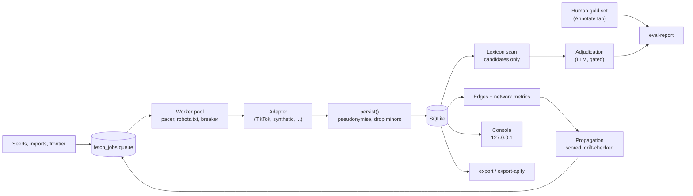

# Architecture

RadicalMap v2 is one Python package (`radicalmap/`) over one SQLite database. The v1 scripts (`scraper/`, `analysis/`, `frontend/`) stay in the repo because the v1.0 release is citable, but nothing in v2 imports them except the v1-vs-v2 comparison in `classify/eval.py`.

## Pipeline

1. **Collect.** Jobs sit in `fetch_jobs` with leases, so a crashed worker's jobs come back after the lease expires. The worker checks robots.txt, waits on a per-host AIMD pacer, and hands the job to the adapter for that job type. Adapters do I/O and return a `CollectResult`. They never write to the database.
2. **Persist.** `collect/persist.py` writes one result in one transaction. Commenter handles become keyed hashes at write time. Accounts the platform flags as under 18 are dropped before anything is written. Links are extracted from every text surface, including deliberately obfuscated forms (`t dot me slash x`).
3. **Classify.** The lexicon proposes candidates and never decides. Adjudication (an LLM, behind `RM_ALLOW_LLM=1`) assigns domain, harm type and stance. Every verdict belongs to a versioned row in `classifier_runs`.
4. **Measure.** Humans label a stratified sample in the console's Annotate tab. `classify eval-report` scores a run against those labels and refuses to report anything without them.
5. **Map.** `graph build` derives edges (authored, uses_tag, uses_sound, co_tag, shares_sound, shares_tag, same_audio, links_to, mentions, alt_of) and node metrics (PageRank, k-core, communities, bridge score).
6. **Propagate.** The frontier proposes new targets from the graph, scored by tie strength, measured yield per edge type, novelty, and drift from the seed set. Every decision is logged to `propagation_events`, so you can reconstruct how the sample was reached.

## Package layout

| Module | Job |
|---|---|
| `core/` | Settings (all from env), keyed-hash pseudonymisation |
| `db/` | Connection engine, migration runner, writers, numbered SQL migrations |
| `collect/` | Worker, pacer, robots.txt, frontier, adapters, importers, persistence, audio, link extraction, Apify-format export |
| `classify/` | Lexicon, candidate scan, adjudication, annotation, evaluation |
| `learn/` | Linear model, active learning, term discovery |
| `propagate/` | Edge builders, propagation engine, scoring, alt-account detection |
| `analyse/` | Precomputed metrics, network algorithms |
| `research/` | Dataset package export, evaluation report |
| `api/`, `web/` | FastAPI console and its static front end |
| `taxonomy.py` | The domain × harm type × stance taxonomy |
| `demo.py` | Offline synthetic demo |

## Schema

Migrations in `radicalmap/db/schema/` are append-only. The runner stores a hash of each applied file and refuses to run if one has been edited since.

| Migration | Tables |
|---|---|
| 001_init | sources, platforms, accounts, account_handles, items, item_metrics, sounds, item_sounds, tags, item_tags, comments, author_identities, transcripts, stickers, links, lexicon_versions, lexicon_entries, classifier_runs, classifications, gold_annotations, fetch_jobs, collection_events, items_fts, comments_fts, transcripts_fts |
| 002_metrics | metrics_runs, tag_cooccurrence, tag_stats, sound_stats, account_stats, daily_volume |
| 003_ordering_indexes | indexes only |
| 004_classification | term_candidates, plus tier/slug/lang on lexicon_entries |
| 005_taxonomy_and_learning | domains, harm_types, stances, model_versions, active_rounds, active_queue, governance_events |
| 006_network | edges, node_metrics, edge_yield, propagation_events, saturation_samples, account_clusters |
| 007_propagation_audit | rebuilds propagation_events with a wider decision set |
| 008_mentions | case-insensitive handle index for the mentions edge |
| 009_network_summaries | edge_type_stats and community_stats, written by each graph build so the Network tab doesn't aggregate on every request |

Two tables need care. `author_identities` is the only place a commenter's handle sits next to its hash; `identity.drop_identities()` empties it before anything leaves the machine. The salt that keys the hashes lives in a file outside the database, so a copied `.db` alone can't reverse them.

Observation and interpretation are separate. Collected facts live on the entity tables. Every judgement lives in `classifications`, tied to the run that produced it, so reclassifying never overwrites data.

## TikTok collection

`collect/adapters/tiktok.py` collects items and profiles. It reads the JSON the page embeds for its own rendering (`collect/adapters/tiktok_web.py` parses it), so it gets the platform sound id and audio URL, structured mentions, bio and link-in-bio, and pinned/ad/region flags. Comments and replies come from the public comment-list endpoints, paced between pages. If a page arrives without the embedded data, the adapter falls back to yt-dlp when `RM_TT_YTDLP_FALLBACK=1` (the default). See the security notes for why that switch exists.

`collect/adapters/tiktok_browser.py` handles discovery only. It runs a real browser for tag and search listings, which have no static data, and returns targets, never items.

Knobs, all environment variables:

| Variable | Default | Effect |
|---|---|---|
| `RM_TT_RESULTS_PER_LISTING` | 200 | Items taken from one tag, profile or search listing |
| `RM_TT_COMMENTS_PER_POST` | 500 | Comment cap per item (0 disables comments) |
| `RM_TT_REPLIES_PER_COMMENT` | 0 | Reply cap per comment |
| `RM_TT_DATE_FROM` / `RM_TT_DATE_TO` | unset | `YYYY-MM-DD` or unix seconds. Applied to listings using the timestamp inside each video id, so out-of-window videos cost no request |
| `RM_TT_EXCLUDE_PINNED` | 0 | Skip pinned posts |
| `RM_TT_TRANSCRIPTS` | 1 | Fetch caption tracks |
| `RM_TT_YTDLP_FALLBACK` | 1 | Fall back to yt-dlp when a page has no embedded data |
| `RM_EXPAND_MENTIONS` | 1 | Queue @-mentioned accounts as frontier targets |

`RM_CACHE_MB` (default 64) sets SQLite's page cache. Raise it for large imports: at 3M comments, 1024 made loading 18% faster.

There is no sort-order option. The public listings come back in platform order, and fetching everything to re-sort it would multiply the request volume.

## Adding a platform

1. Write an adapter in `collect/adapters/` implementing `Adapter` from `base.py`: `handles(job_type)`, `async run(job) -> CollectResult`, and `target_for(node_type, node_id, row)`, which turns a graph node back into something this adapter can fetch.
2. Keep parsing pure and separate from fetching, so it can be tested on fixtures. `tiktok_web.py` is the pattern.
3. Raise `AdapterError` for retryable failures and `PermanentError` for ones that will never succeed. A deleted post must not burn five retries.
4. Check `settings.allow_network` before any request.
5. Register a mapping for `collect/importers/corpus.py` if the platform has a common export format.
6. Add offline tests with synthetic fixtures. Nothing in `tests/` may touch the network.
